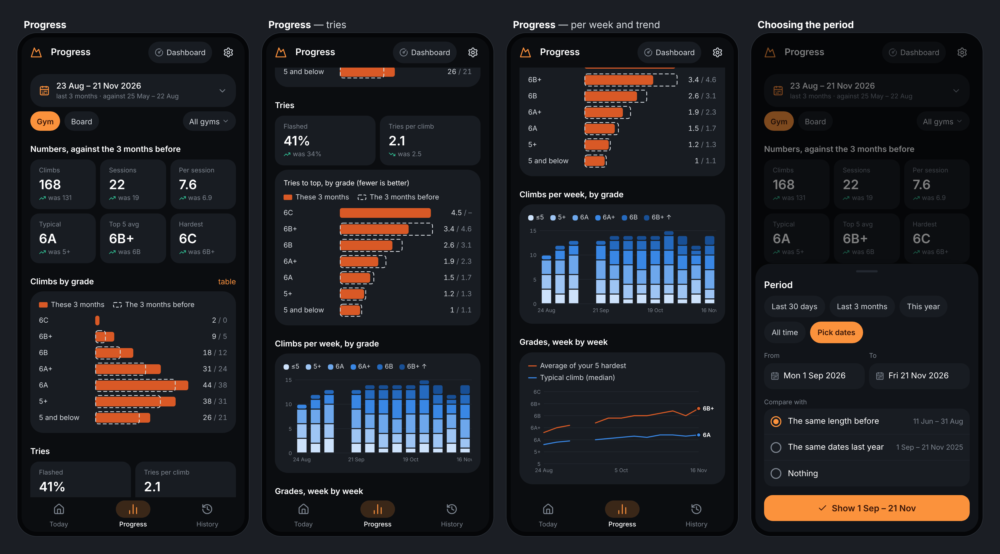
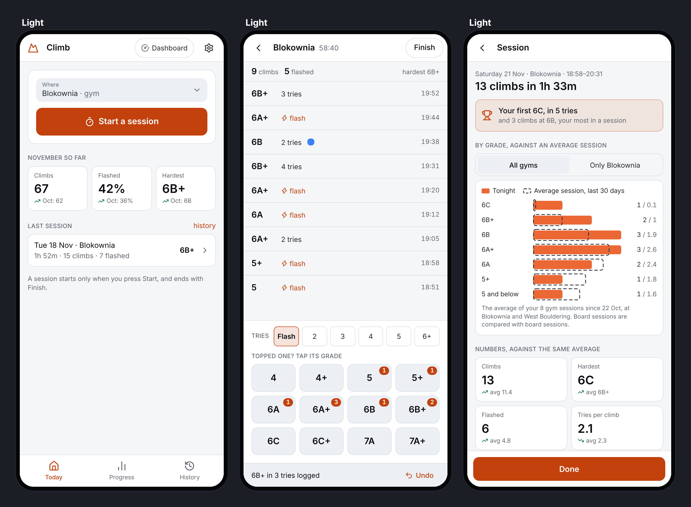

# Climbing log: design

**Status:** built, in the eight steps of the Plan below; the screenshots
are from the design's prototype (branch `proto/climb`). Where the build
differs from the design, this document says so. Boards are left out for
now: the log has gyms only (see Data model).
Nothing is built yet. The screenshots come from a prototype with sample data
(branch `proto/climb`, not for merging), so both the features and the look
can still change.

## In short

- **A second app in this repository,** made for a phone at the gym:
  bouldering at gyms and on boards (Kilter, MoonBoard…). It has its own page
  (`/climb/`) and its own icon on the home screen. The dashboard links to
  it, and it links back; nothing else connects them.
- **You log by grade:** when you top a problem, tap its grade. A flash is
  one tap; if it took more tries, tap the number of tries first. Undo is in
  the bar at the bottom.
- **Colours are optional:** a label you can add to a climb afterwards, to
  tell problems apart. They're never part of logging, and no chart uses
  them.
- **What it's for:**
  - how many climbs you complete, at which grades, and in how many tries;
  - whether that's getting better: against your past sessions, and over a
    period you pick.
- **Its data is kept apart from the dashboard's:**
  - its own protobuf schema;
  - its own storage on the phone;
  - its own file on Drive.

  The code that saves and syncs is shared.

## Your answers so far

| Question | Answer | What it means here |
|---|---|---|
| Ropes too? | Bouldering first | No ropes in the first version. The data leaves room for them. |
| Log by colour or by grade? | By grade | The logging buttons are Font grades. Colours are only an optional label on a climb. |
| Count tries? | Yes | Each climb has its tries: 1 is a flash. Flashes and tries per climb are measured. |
| Accent | Orange | Kept. |
| Should the dashboard know about climbing? | No, now or ever | Only the links. A session never starts by itself, from the calendar or anything else: only **Start**. |
| Boards | Yes, sometimes | Boards are a kind of place: the same grade buttons, and the board's angle per session. Charted apart from the gyms. |
| Photos | No | Out. |
| Goals | None for now | Out. |
| After a session, compare with… | Your sessions of the last month, anywhere | All your gym sessions of the last 30 days by default; only this gym's is a separate switch. |
| The name | "Climb" | Kept. |
| The look | Soft, of three proposed | Filled blocks with no outlines; see The look. |

**Projects stay out.** In climbing, a project is a problem you keep working
on over several sessions until you top it. The log counts tries on climbs
you top, not tries on problems you didn't, so there's nothing for a project
to show yet. See the open questions.

## User stories

**At the gym:**
1. When I arrive, I tap **Start**. I want the gym I went to last to be
   picked already, so starting takes one tap.
2. When I top a problem first go, I tap its grade: one tap, so it doesn't
   break my rest.
3. When it took me more tries, I tap the number of tries, then the grade.
   The tries go back to Flash after each climb, so I never carry a wrong
   number over.
4. When I tap the wrong grade or tries, one **Undo** fixes it, or I tap the
   climb in the list and change it.
5. When I want to tell problems apart, I tap a climb and add its colour or
   a name. It's never required.
6. On the board, it's the same, and the board's angle is kept with the
   session.
7. When I'm done, I tap **Finish**. I see my climbs by grade against my
   average session of the last 30 days, at all gyms (or only this one),
   and any firsts ("your first 6C").

**Later, at home:**
8. I pick any period (last 30 days, 3 months, this year, all time, or two
   dates) and see how many climbs I did and at which grades, against the
   period before.
9. I see whether my grades are going up: my typical climb and my 5 hardest,
   week by week.
10. I see whether I need fewer tries: how many I flash, and my tries per
    climb at each grade, against the period before.
11. I see how my volume changes: climbs per week, by grade.
12. I see how often I climb: sessions a week.
13. I look at boards apart from the gyms, and at one gym apart from the
    others, since grades aren't the same everywhere.

**Setting up and my data:**
14. I set the range of grade buttons once (4 to 7A+ at gyms, say), and add
    my gyms and boards. A gym's colour labels are optional.
15. My climbing data is mine and separate from the dashboard: its own file,
    exportable, synced to my Drive if I want.

## What to measure

What climbers and coaches track to see progress:

| Measure | Why | Where |
|---|---|---|
| **Climbs**, in a session and in a period | Volume: the simplest sign you're climbing more | After the session; Progress; Today |
| **Climbs by grade** (the "pyramid") | Progress shows as the middle and the top filling in. Coaches suggest about 3–4 climbs of each grade for every one of the grade above before pushing it. | After the session; Progress |
| **Typical grade** (the median) | The grade you mostly climb. One odd session barely moves it. | Progress: a number, and a line week by week |
| **Average of your 5 hardest** | Your level at the top, steadier than the single hardest climb: one lucky send doesn't make it jump. The same idea as 8a.nu's ranking, which counts your best 10 ascents. | Progress: a number, and a line week by week |
| **Hardest climb** | Motivating, but noisy | Progress; After the session (firsts) |
| **Flashed** (share of climbs topped first go) | A grade you flash is a grade you own; a rising share at the same grades means you're getting stronger before the top grade moves | After the session; Progress; Today |
| **Tries per climb**, overall and by grade | Fewer tries at a grade is progress at that grade, often weeks before you climb a harder one | After the session; Progress |
| **Sessions a week** | Consistency, which is what makes the rest move | History; Progress |
| **Climbs per session** | How much you get out of a session | Progress |

**Left out:**
- **Send rate** (topped ÷ tried): it needs the problems you tried and
  didn't top, which aren't logged (see the open questions).
- **A cumulative score** (e.g. a log-weighted "performance grade"): harder to
  read than the measures above, for little more.

**Caveats:**
- **Grades differ between gyms.** The session comparison and Progress can
  show one gym on its own.
- **Boards grade harder, and depend on the angle.** Board climbs are always
  charted apart from the gyms.
- **Tries start at Flash.** Forgetting to set them logs a flash, so the
  flash share can run a little high; Undo or tapping the climb fixes it.

## Charts and numbers

**After the session:**
- **"By grade, against an average session"** (first image, 4th screen):
  - **The bars:** one row per grade, hardest first; tonight is a filled
    orange bar, and your average session is a long-dashed outline, not
    filled, on the same scale.
  - **The numbers** beside each row: "3 / 1.9".
  - **The average** is over your gym sessions of the 30 days before, at all
    gyms; **Only Blokownia** switches to that gym's. It never counts
    tonight. A board session is compared with board sessions.
- **Four numbers,** each against that average: climbs, hardest, flashed,
  tries per climb (where fewer is better).
- **Firsts:** a grade above any before, the most climbs of a grade in a
  session, the most flashes.

**Progress, for any period you pick:**
- **The period:**
  - presets (last 30 days, last 3 months, this year, all time) or two
    dates;
  - compared with the same length just before (the default), the same dates
    a year earlier, or nothing.
- **Gym or Board,** and all gyms or one.
- **Six numbers,** each against the comparison period: climbs, sessions,
  climbs per session, typical grade, average of the 5 hardest, hardest.
- **Climbs by grade:** the same bars as after the session. This period is
  filled; the comparison period is the dashed outline.
- **Tries:** flashed and tries per climb, then **tries to top, by grade**:
  the same bars, where a shorter filled bar than the outline means fewer
  tries than before.
- **Climbs per week, by grade:** stacked columns, easy at the bottom in
  light blue, hard at the top in dark blue. A darker top over the weeks
  means harder climbs.
- **Grades, week by week:** two lines on the grade scale, the average of
  your 5 hardest and your typical climb. A week without climbing is a gap,
  not a zero.
- **Every chart has a table** of the same numbers ("table"). Tapping a bar
  or a point shows its numbers.

**History:** sessions a week, then every session, with its place, length,
climbs, flashes and hardest climb.

**Colours in charts:**
- **Kept:** the dashboard's chart rules, checked with the same
  colour-blindness and contrast tests on the surface the charts sit on (the
  filled blocks), dark and light. In light mode, the grade blues start a
  step darker than the dashboard's so the lightest one shows on the block.
- **One series:** orange; the past is always a long-dashed outline in the
  text colour.
- **Two lines:** orange and blue.
- **Grades:** one blue, light to dark.
- **Readable without colour:** every chart has a legend and numbers on it.
- **Gym colours never appear in charts.**

## The look

Soft, picked from three proposals (bordered panes, open with no blocks, and
soft):
- **Blocks are filled shapes** with round corners and no outlines: a step
  lighter than the background in dark mode, a step darker in light mode.
- **Choices are pills** (the tries, all gyms or one, Gym or Board, the
  period); the chosen one is filled orange.
- **The grade buttons** are big rounded tiles; tonight's count is an orange
  badge on each.
- **Big buttons** (Start, Done, Save) are orange, with round corners.
- **The undo bar floats** above the bottom edge, and the current tab has a
  pill behind its icon.
- **The same base as the dashboard:** its colours for the background, text
  and lines, its font, dark and light; the log has its own accent (orange)
  and these shapes.

The prototype keeps the other two for comparison (`?look=panes`,
`?look=open`).

## Screens

**Getting around:**
- **Tabs:** Today, Progress, History.
- **Top right:** **Dashboard** and Settings.
- **A running session** is a screen of its own, without tabs.

**Each screen:**
- **Today:**
  - where you'll climb (the last place, changeable) and **Start a session**;
  - this month so far against the last: climbs, flashed, hardest;
  - the last session.
- **At the gym:**
  - the gym and the time so far, with **Finish**;
  - climbs, flashes and the hardest so far;
  - the climbs so far, newest first: grade, tries, and a colour or name if
    one was added;
  - at the bottom, in the thumb's reach: the tries (**Flash**, 2, 3, 4, 5,
    6+; 6+ turns into a counter), then the grades as big buttons, each with
    tonight's count;
  - the undo bar.
- **A climb, tapped in the list:** a sheet to change its grade and tries,
  add a colour or a name, or delete it.
- **On a board:** the same, with the board's grade buttons, and the angle
  next to the counts (changeable).
- **After the session:** firsts, the comparison chart with its switch, the
  numbers, notes, **Done**.
- **Progress:** see Charts and numbers.
- **History:** sessions a week, and every session.
- **Settings:**
  - **Grades:** Font or V, and the range of buttons at gyms and on boards.
  - **Gyms:** each with its optional colour labels.
  - **Boards.**
  - **Data:** export and import, Drive sync.
  - **The theme.**

**How many taps:**

| To… | Taps |
|---|---|
| Start a session at the usual gym | 1 |
| Log a flash | 1 |
| Log a climb in 2–5 tries | 2 |
| Undo it | 1 |
| Add a colour to a climb | 3 (the climb, the colour, Save) |
| Finish and see how it went | 1 |
| Change the period on Progress | 2–3 |

## Grades

- **Gyms and boards:** Font by default, V if chosen in Settings. The
  buttons cover a range you set (12 fit without scrolling: 4 to 7A+, say).
- **Boards:** the angle per session. MoonBoards run at 25° or 40° (the same
  problem is easier at 25°); Kilter boards from 0° to 70°. Board climbs are
  never mixed with gym climbs in charts.
- **Charts are in the grades you log in.** If you change from Font to V, the
  older climbs are converted with the table below and marked with "≈". The
  sources agree on the ends but differ in the middle of the scale.

| Font | 4 | 5 | 5+ | 6A, 6A+ | 6B, 6B+ | 6C, 6C+ | 7A | 7A+ | 7B, 7B+ | 7C | 7C+ | 8A |
|---|---|---|---|---|---|---|---|---|---|---|---|---|
| **V** | V0 | V1 | V2 | V3 | V4 | V5 | V6 | V7 | V8 | V9 | V10 | V11 |

## Where it lives

- **Code:** this repository, the same build. The log is a second page,
  `climb/index.html`, with its code in `src/climb/`.
- **Address:** `https://wps0.github.io/personal-dashboard/climb/`.
- **Links:** plain links in the same tab, and nothing else. From the
  dashboard: "Climbing" after the page tabs on a computer; a mountain icon
  next to Settings on a phone with tabs; "Climbing log" under Other apps in
  the ☰ menu. In the log, **Dashboard** at the top of every screen goes
  back.
- **Its own install:** its own manifest, name ("Climb") and icon. To check
  in the first PR: that Android installs it as an app of its own, since its
  address sits inside the dashboard's.
- **Offline:** one service worker for both pages. The log works at the gym
  without a signal.

### The data, kept apart

| | Dashboard | Climbing log |
|---|---|---|
| Schema | `proto/dashboard/data.proto`, package `dashboard` | `proto/climb/climb.proto`, package `climb` |
| Generated code | `src/gen/dashboard/` | `src/gen/climb/` |
| Schema version, migrations | its own | its own, from 1 |
| On the device | its IndexedDB database | another IndexedDB database, `climb` |
| On Drive | `personal-dashboard.binpb` (+ `.json`) | `climb.binpb` (+ `climb.json`) |
| Lock against two open tabs | its own | its own |

- **Neither imports the other's schema or model.** A change to one can't
  break the other, and each file can be exported, imported or deleted on
  its own.
- **Shared, made generic over the schema and the names** (`src/saving/`,
  `src/google/`):
  - the codec (binary and JSON, the schema version check, migrations);
  - autosave, and the one-tab lock;
  - IndexedDB storage;
  - the Drive sync algorithm with its three-way merge, and the Drive file
    operations (each app with its own file names and marker);
  - loading Google sign-in, and the Client ID.
- **The log's own:** its sign-in (Drive only, the `drive.file` scope; the
  token kept in the tab), its sync runner, and its merge rules (a session
  or place deleted on one device comes back if the other used it).
- **Differences from the dashboard's sync:** a first sync with different
  data on Drive merges both instead of asking (climbs have their own ids,
  so nothing is lost or doubled); a value changed on both devices keeps
  this device's, with a notice, and there's no review screen.
- **The first PR is that refactor alone,** with no change to the dashboard.
  Tests show it reads and writes exactly the bytes it did before.
- **The Google Client ID setting is shared,** so it's set once; sign-in is
  per app.
- **Both apps are on the same origin** (see the dashboard's own-subdomain
  TODO); the log's only secret is the Google token.

## Data model

The schema is `proto/climb/climb.proto`:
- **Gyms** with optional colour labels.
- **Sessions** at a gym, with a start and an end (timestamps) and their
  climbs inside them.
- **Climbs:** when, the grade, tries, and an optional colour and name.
- **Grades** are enums (`FontGrade`, `VGrade`), in a `Grade` message's
  oneof that also says the scale.
- **Settings:** the range of grade buttons, whose scale the log uses.

Boards (a kind of place, the board angle) are left out for now; adding
them later is adding fields, which older versions keep.

## What the numbers mean

- **A climb:** one problem topped, logged with one tap on its grade.
- **Tries:** how many goes it took to top it, counting the one that worked;
  1 is a flash.
- **Flashed:** climbs in 1 try ÷ all climbs (a count after a session, a
  share on Progress and Today).
- **Tries per climb:** all tries ÷ climbs; by grade, the same for the climbs
  of that grade.
- **Typical grade:** the median of the period's climbs' grades.
- **Average of the 5 hardest:** the period's 5 hardest climbs, averaged on
  the grade scale and shown as the nearest grade. With fewer than 5 climbs,
  it's the average of those there are.
- **Average session** (after the session): climbs per grade, averaged over
  your gym sessions (or board sessions) in the 30 days before, at all gyms
  or only this one.
- **The comparison period:** by default the same length just before ("the
  3 months before").
- **A first:** a grade above every earlier climb of that kind (gym or
  board), or the most climbs of a grade, or the most flashes, in a session.

## Plan

Small PRs, each checked in the browser like the dashboard's:

1. **Generic saving:** the saving code made generic over the schema (the
   dashboard unchanged, its bytes checked).
2. **The shell:** the `/climb/` page, its tabs, the links both ways, the
   manifest and icon, and the service worker.
3. **The data:** `climb.proto`, storage and autosave, export and import;
   Settings for grades, gyms (with colour labels) and boards.
4. **Sessions:** start and finish, logging by tries and grade at gyms and on
   boards, undo, and the sheet to change a climb.
5. **After the session:** the comparison chart and its switch, the numbers,
   firsts.
6. **Progress:** the period picker, the numbers, climbs by grade, tries,
   climbs per week, the grade lines, and the tables.
7. **History.**
8. **Drive sync** to `climb.binpb`.

## Open questions

1. **Problems you tried and didn't top:** log them too (say, a long press on
   a grade)? That would bring back the send rate, and projects with it.
   Left out for now: logging stays "topped, in N tries".
2. **Tries before or after the grade:** before (as shown: pick 3, then tap
   6B), or after (tap 6B, then 3 on the climb that was just logged)?
3. **The board angle:** per session (as shown), or per climb?
4. **Board sessions after the session:** compared with all your board
   sessions of the last 30 days (as shown), or only with the same board at
   the same angle?

## Sources (checked November 2026)

- What to track and how pyramids are read:
  - [ClimbStrong: quantifying bouldering sessions](https://climbstrong.com/education-center/quantifying-bouldering-sessions);
  - [8a.nu: the base of your pyramid](https://www.8a.nu/news/focus-on-the-grade-base-of-your-pyramid);
  - [Power Company: not all pyramids are built the same](https://powercompanyclimbing.squarespace.com/blog/2020/5/6/not-all-pyramids-are-built-the-same);
  - [Mountain Project: a "stable pyramid"](https://mountainproject.com/forum/message/111542163);
  - [AscentStats: a cumulative performance grade](https://ascentstats.com/cumulative-performance-grade/);
  - [KAYA Pro](https://kayaclimb.com/blog/whats-kaya-pro).
- Ranking on your best ascents:
  - [8a.nu user guide](https://www.8a.nu/articles/user-guide-and-faq-1327);
  - [8a.nu on the top-10 ranking](https://www.8a.nu/news/-49730).
- Boards:
  - [Moon Climbing: using your MoonBoard](https://eu.moonclimbing.com/using-your-moonboard);
  - [Lattice: a MoonBoard logbook](https://latticetraining.com/blog/ben-moons-moonboard-logbook);
  - [theCrag: Kilter logbooks](https://www.thecrag.com/en/climbing/virtual/area/5170450323/search).
- Font and V: [Masterclass](https://www.masterclass.com/articles/bouldering-grades-explained),
  [Planetmountain](https://www.planetmountain.com/news/2004/03/boulderinggrades.html),
  [Mammut](https://www.mammut.com/es/en/stories-guides/bouldering-difficulty-scales-explained-climbers-guide),
  [DPM Climbing](https://www.dpmclimbing.com/?p=1314).
- Logbook apps:
  - [TopLogger](https://apps.apple.com/au/app/toplogger/id1289479862);
  - [Sendtally](https://play.google.com/store/apps/details?id=com.sendtally.app);
  - [BetaFlow](https://apps.apple.com/us/app/id6752315334).
