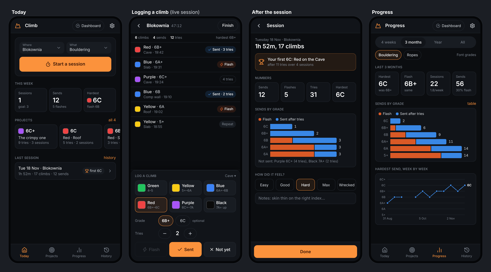
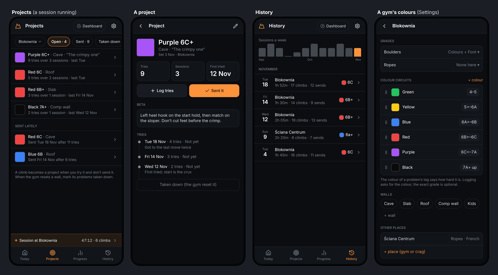
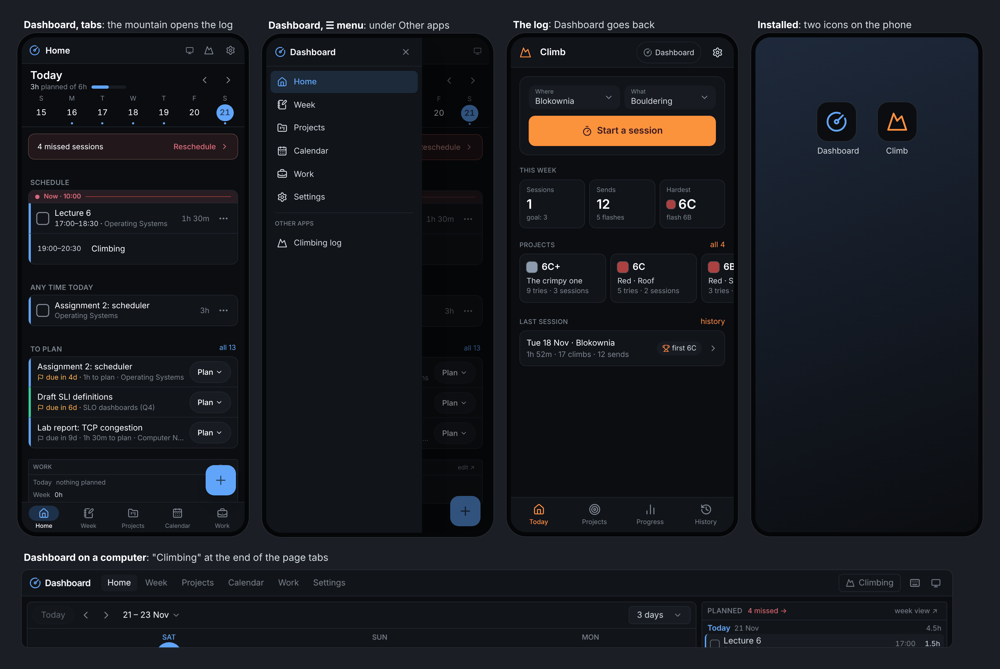
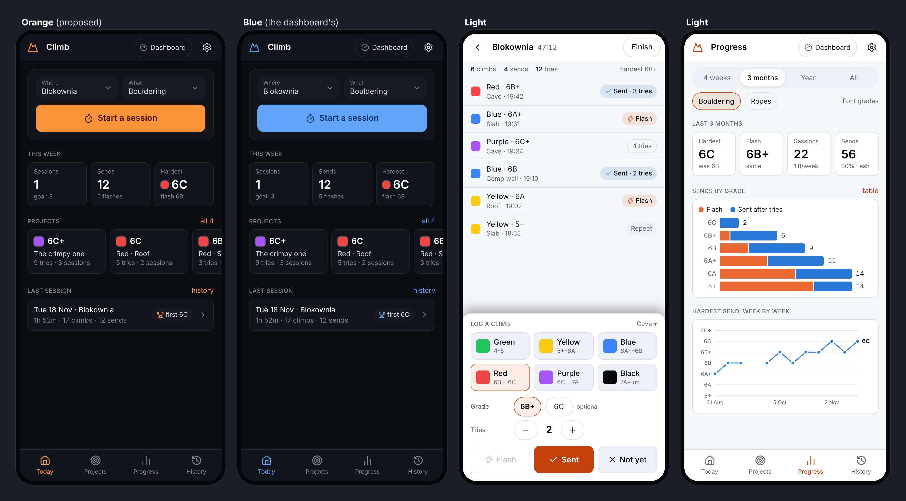

# Climbing log: design

**Status:** proposal, nothing built yet. The screenshots come from a
prototype with sample data (branch `proto/climb`, not for merging), so the
look can be changed before any of it is built.

## In short

- **A second app in this repository:** a log for bouldering and rope
  climbing, made for a phone at the gym. It has its own page (`/climb/`), its
  own icon on the home screen and its own data. The dashboard links to it, and
  it links back.
- **Logging a climb takes two or three taps:** its colour (or grade), then
  **Sent**, **Flash** or **Not yet**. The number of tries starts at 1, with
  − and + beside it.
- **It shows whether you're getting better:**
  - your hardest send and flash over time;
  - sends by grade (a pyramid);
  - your projects (problems tried but not sent yet);
  - every session.
- **Local first:** it works offline at the gym. Drive sync is optional and
  uses a file of its own, as the dashboard does.









## Goals

- **Log during a session with one hand,** between climbs, with chalky
  fingers and a short rest:
  - targets at least 48px, big ones in the bottom half of the screen;
  - nothing to type;
  - every change undoable from the undo bar (as in the dashboard, SPEC 3.6).
- **See whether you're getting better:**
  - your hardest grade, sent and flashed, over time;
  - how many climbs at each grade;
  - how a project is going.
- **Keep what the gym says:** the colour and the grade on the tag, as
  written. Nothing logged is ever converted. Conversions are only for
  charts, and they're marked as approximate.
- **Your data:** it stays on the phone, in an export, or in your own Drive.

**Not in the first version:**
- friends, feeds or rankings;
- gym route databases (TopLogger and the like);
- outdoor guidebooks and topos;
- training plans (hangboard, campus board);
- videos and watches.

## What it tracks

| Thing | What it is | Example |
|---|---|---|
| **Place** | A gym or a crag: its grade systems, its colour circuits, its walls | Blokownia: boulders by colour, also Font |
| **Problem** (a route on ropes) | One climb at a place, kept across sessions: its colour, grade (optional where colours give the range), wall, a name if you like, and beta notes. Marked taken down when the gym resets it | Purple 6C+ on the Cave, "The crimpy one" |
| **Session** | One visit: place, start and end, how it felt, notes | Tue 18 Nov, 19:05–20:57 |
| **Climb** (one log entry) | One problem in one session: what happened and in how many tries | Red 6B+, sent in 3 tries |

**What happened**, one of:
- **Flash:** sent on the first try ever;
- **Sent:** after more tries;
- **Repeat:** sent before, sent again;
- **Not yet:** tried, not sent.

On ropes, **onsight** (first try, no beta) is a kind of flash: it's kept in
the data, but the first version doesn't ask for it.

**A project** is a problem you've tried and not sent, still on the wall. It
leaves the project list when you send it or mark it taken down.

**Logging, step by step** (the second screenshot of the first image):
1. **The colour,** with its grade range under it ("Red 6B+–6C").
2. **The exact grade,** if the tag says it (optional).
3. **Tries:** 1 at first; − and + change it.
4. **Sent, Flash or Not yet,** which logs it. Flash is only offered at
   1 try.

The wall at the top of the panel ("Cave ▾") stays as last picked, since you
often climb several problems on one wall. Logging the same colour, grade and
wall as an open project adds to that project: "Purple 6C+ on the Cave: 4 more
tries, 13 now".

## Grades

| Climbing | Systems offered | Polish gyms mostly |
|---|---|---|
| Boulders | Font (6A, 6A+, 6B…), V (V0–V17), or the gym's colours, each a range of Font or V | Colours, often with Font on the tag |
| Ropes | French (6a, 6a+…), Kurtyka (VI, VI.1, VI.1+…), YDS (5.10a…), UIAA | French or Kurtyka |

**Each place has its own systems,** and a climb keeps its grade as the gym
writes it.

**Charts show one kind of climbing at a time** (boulders or ropes, never
mixed), in the system set in Settings: Font and French unless changed.
- A grade in another system is converted for the chart only, using tables
  in the code, and marked with "≈".
- A climb logged only by colour counts at the low end of its colour's range:
  "at least 6B+" for red, never a guessed exact grade.

**The conversion tables** are approximate. Sources disagree in the middle
of the scales, and gyms grade differently anyway.

| Font | 4 | 5 | 5+ | 6A, 6A+ | 6B, 6B+ | 6C, 6C+ | 7A | 7A+ | 7B, 7B+ | 7C | 7C+ | 8A |
|---|---|---|---|---|---|---|---|---|---|---|---|---|
| **V** | V0 | V1 | V2 | V3 | V4 | V5 | V6 | V7 | V8 | V9 | V10 | V11 |

| French | 5a | 5b | 5c | 6a | 6a+ | 6b | 6b+ | 6c | 6c+ | 7a | 7a+ | 7b | 7b+ | 7c | 8a |
|---|---|---|---|---|---|---|---|---|---|---|---|---|---|---|---|
| **Kurtyka** | V | V+ | VI- | VI | VI+ | VI.1 | VI.1+ | VI.2 | VI.2+ | VI.3 | VI.3+ | VI.4 | VI.4+ | VI.5 | VI.6 |

The French–Kurtyka row is the one usually quoted. The sources found online
don't confirm it row by row (see Sources), so it gets checked against a
Polish table in the PR that adds it.

## Screens

The app is made for phones. On a computer it shows in a column of phone
width.

**Getting around:**
- **Tabs:** Today, Projects, Progress, History.
- **Top right:** **Dashboard** and Settings.
- **The session** is a screen of its own, without the tabs. Left for another
  tab, it waits in a bar above the tabs ("Session at Blokownia · 47:12 · 6
  climbs").

**Today:**
- where and what: the last place and the last kind of climbing, both
  changeable;
- **Start a session**;
- this week: sessions (against a weekly goal, if set), sends, the hardest
  send and the hardest flash;
- your projects, sideways;
- the last session.

**The session:**
- **The header:** the place, the time so far, **Finish**.
- **The list:** what you've logged, newest first, each with what happened.
  A tap edits it: the wall, name, tries, notes.
- **The logging panel** at the bottom, in the thumb's reach (see What it
  tracks).
- **The screen stays on** (Screen Wake Lock), so the phone doesn't lock
  between climbs. This can be turned off in Settings.

**After the session:**
- its length and number of climbs;
- personal bests ("Your first 6C: Red on the Cave, after 11 tries over 4
  sessions");
- sends, flashes, tries and the hardest send;
- this session's sends by grade, and what wasn't sent;
- how it felt (Easy to Wrecked), and notes.

**Progress:**
- **The period:** 4 weeks, 3 months, a year or all.
- **Boulders or ropes.**
- **Four numbers:** the hardest send, the hardest flash, sessions (and how
  many a week) and sends (and how many of them flashed).
- **Sends by grade:** a bar for each grade, flashes and other sends in two
  colours, with the total at the end. A tap on a bar shows its numbers;
  "table" shows the same numbers as a table.
- **Hardest send, week by week:** a line on the grade scale, with a gap
  where a week had no session.

**Projects:**
- open, sent or taken down, at one place or all;
- each project's tries, sessions and when it was last tried.

**A project:**
- its colour, grade, wall and name;
- tries, sessions and when it was first tried;
- **Log tries** and **Sent it**;
- beta notes;
- every session's tries;
- **Taken down**.

**History:**
- sessions a week, as small bars;
- every session, with its place, length, climbs, sends and hardest send.

**Settings:**
- **Places:**
  - the grade systems for boulders and ropes;
  - colour circuits, each a colour and its range, in order;
  - walls.
- **Charts:** the grade systems they use.
- **Weekly goal.**
- **The theme.**
- **Data:** export and import (JSON), and Drive sync.
- **Keep the screen on during a session.**

**Charts** follow the same rules as the dashboard's:
- **Two colours:** flash (orange) and other sends (blue), the same in every
  chart and badge. Both pass the colour-blindness and contrast checks on the
  dark and the light background.
- **Readable without colour:** a legend and numbers on the bars, so colour
  is never the only cue.
- **Thin marks:** bars at most 24px thick, 2px lines, 8px points.
- **A table view** of the same numbers.

### How many taps

| To… | Taps |
|---|---|
| Start a session | 1 (2 to change the place) |
| Log a climb by its colour | 2: colour, Sent (3 with the exact grade, more with tries) |
| Log a flash | 2: colour, Flash |
| Undo the last one | 1 |
| Finish, saying how it felt | 3: Finish, a feeling, Done |
| Mark a project sent from its page | 1 |
| See your hardest grade | 1: Progress |

## Look

**Same family as the dashboard:**
- the same font (Inter), backgrounds, lines and components;
- dark first, light too.

**Made for a phone:**
- text 15–17px;
- buttons 44–56px high;
- the main buttons at the bottom.

**The accent** tells the two apps apart: chalk orange is proposed, and the
dashboard's blue is the alternative (fourth image). The gyms' colours appear
as swatches only, with black and white given a ring so they show on both
backgrounds.

## Where it lives

- **This repository, the same build:**
  - a second page, `climb/index.html`;
  - code in `src/climb/`, which doesn't import the dashboard's store or
    model;
  - what it shares: the styles (`src/index.css`), the general components
    (popover, select, undo bar), and the Google sign-in and Drive code.
  - When the phone-app work splits the repository into workspaces
    (`docs/phone_app.md`), this becomes `apps/climb`.
- **Address:** `https://wps0.github.io/personal-dashboard/climb/`.
- **Links:** plain links, opened in the same tab.

  | From | To | Where the link is |
  |---|---|---|
  | Dashboard, computer | Climbing log | "Climbing", after the page tabs |
  | Dashboard, phone with tabs | Climbing log | A mountain icon next to Settings |
  | Dashboard, phone with the ☰ menu | Climbing log | "Climbing log", under Other apps |
  | Climbing log | Dashboard | **Dashboard**, at the top of every screen |
- **Its own install:**
  - `climb/manifest.webmanifest`: name "Climb", its own icon, start and
    scope `/climb/`;
  - the phone shows two icons (third image).
  - **To check in the first PR:** that Android installs it as an app of its
    own, since its scope sits inside the dashboard's. If it doesn't, the
    two apps move to sibling paths (`/app/` and `/climb/`), which also moves
    the dashboard's address.
- **Offline:** one service worker for both, not two nested ones.
  - The dashboard's worker is registered for the whole site, so its scope
    already includes `/climb/`.
  - It would also cache `climb/index.html`.
  - The built files are shared by both pages and already cached.
- **Storage:** the same origin as the dashboard, kept apart:
  - its own IndexedDB store and its own `climb/` keys in localStorage;
  - its own lock against two open tabs;
  - its data as protobuf binary (`proto/climb/climb.proto`), with a JSON
    export.
- **Drive sync:** optional, to its own file, `climb.binpb`.
  - It uses the dashboard's sync, with its three-way merge.
  - The OAuth Client ID setting is shared (the same localStorage), so it's
    set once.
  - Sign-in is per app: the token is kept per tab.
- **Security:** the same as the dashboard's. It's on the shared
  `wps0.github.io` origin, with the same content security policy, and its
  only secret is the Google token. Moving to the dashboard's own subdomain
  (SPEC 5) moves both.

## Data model (sketch)

Following the dashboard's rules (SPEC 6):
- numeric enums, each with an unset value;
- no nested messages;
- fields numbered from 1;
- `optional` where a field can be unset;
- a schema version from the start.

```proto
message ClimbData {
  int32 schema_version = 1;
  repeated Place places = 2;
  repeated Problem problems = 3;
  repeated Session sessions = 4;
  repeated Climb climbs = 5;
  Settings settings = 6;
}

message Place {
  string id = 1;
  string name = 2;
  GradeSystem boulder_grades = 3;  // FONT, V, or COLOURS with circuits
  GradeSystem rope_grades = 4;     // FRENCH, KURTYKA, YDS, UIAA; unset: no ropes
  repeated Circuit circuits = 5;   // easiest first
  repeated string walls = 6;
  bool archived = 7;
}

message Circuit {
  string colour = 1;               // "#ef4444"
  string name = 2;                 // "Red"
  optional string lowest = 3;      // "6B+"
  optional string highest = 4;     // "6C"; unset: and up
}

message Problem {
  string id = 1;
  string place_id = 2;
  Discipline discipline = 3;       // BOULDER, TOP_ROPE, LEAD, AUTO_BELAY
  optional string colour = 4;      // a circuit's name, or the holds' colour
  optional string grade = 5;       // as on the tag, in the place's system
  optional string wall = 6;
  optional string name = 7;
  string beta = 8;
  optional string taken_down_on = 9;
  string created_at = 10;
}

message Session {
  string id = 1;
  string place_id = 2;
  string date = 3;                 // YYYY-MM-DD
  optional string start = 4;       // HH:MM
  optional string end = 5;
  Feeling feeling = 6;             // EASY … WRECKED; unset: not said
  string notes = 7;
}

message Climb {
  string id = 1;
  string session_id = 2;
  string problem_id = 3;
  Result result = 4;               // FLASH, ONSIGHT, SENT, REPEAT, NOT_YET
  int32 tries = 5;
  optional string at = 6;          // HH:MM
  string notes = 7;
}

message Settings {
  GradeSystem chart_boulder_grades = 1;
  GradeSystem chart_rope_grades = 2;
  optional int32 weekly_goal = 3;
  bool keep_screen_on = 4;
}
```

## What the numbers mean

- **Hardest send:** the highest grade sent (flash, onsight, sent or repeat)
  in the period.
- **Hardest flash:** the same, for flashes and onsights only.
- **Sends by grade:** each problem counted once per period, at its first
  send in it; the flash part is the problems flashed.
- **Personal best:** a send above every earlier send of that kind of
  climbing ("Your first 6C").
- **Flash rate:** flashes out of sends.
- **Volume:** climbs and tries per session; sessions a week.

## Plan

Small PRs, each checked in the browser like the dashboard's:

1. **The shell:**
   - the `climb/` page, with the tabs and header;
   - the links both ways;
   - the manifest and icon;
   - the service worker caching the page.
2. **The data:**
   - the proto, storage and autosave;
   - export and import;
   - places and the grade tables (with tests, conversions included);
   - Settings for places, circuits and walls.
3. **Sessions:** start and finish, the logging panel, the undo bar, and the
   screen after the session.
4. **Problems and projects:** logging adds to an open project; the project
   list and page; taken down.
5. **Progress:** the four numbers, sends by grade, the weekly line, and the
   table view.
6. **History.**
7. **Drive sync.**

## Open questions

1. **Your gym(s):**
   - does a colour say how hard a problem is (circuits), or does each tag
     have a Font grade with any colour of holds?
   - The prototype assumes circuits, with Font optional.
2. **Ropes:** in the first version (top rope and lead, French or Kurtyka),
   or bouldering first?
3. **Tries:** count them, or only sent / not yet?
4. **The accent:** orange, or the dashboard's blue?
5. **The name:** "Climb"?
6. **Should the dashboard know about climbing?**
   - It could, for example, start a session from a planned "Climbing" event
     in its calendar, or show sessions in its week.
   - Proposed: not in the first version, only the links.
7. **Boards** (MoonBoard, Kilter): out of scope?
8. **Photos of problems,** to recognise them weeks later: later, since they
   take space and sync time.
9. **The weekly goal** on Today: keep it?

## Sources (checked November 2026)

- Bouldering grades (Font and V): [Masterclass](https://www.masterclass.com/articles/bouldering-grades-explained),
  [Planetmountain](https://www.planetmountain.com/news/2004/03/boulderinggrades.html),
  [Mammut](https://www.mammut.com/es/en/stories-guides/bouldering-difficulty-scales-explained-climbers-guide),
  [DPM Climbing](https://www.dpmclimbing.com/?p=1314).
- The Kurtyka scale: [8a.pl](https://8a.pl/8academy/skala-wspinaczkowa/),
  [theCrag](https://www.thecrag.com/en/article/grades),
  [Rab](https://rab.equipment/us/rab-lab/climbing-grade-converter),
  [UIAA](https://www.theuiaa.org/documents/sport/THE-SCALES-OF-DIFFICULTY-IN-CLIMBING_p1b.pdf).
- What logbook apps track (flash, send, tries, projects, pyramids):
  [TopLogger](https://apps.apple.com/au/app/toplogger/id1289479862),
  [Sendtally](https://play.google.com/store/apps/details?id=com.sendtally.app),
  [BetaFlow](https://apps.apple.com/us/app/id6752315334),
  [Flashd](https://apps.apple.com/us/app/flashd/id6759596452).
- Warsaw's bouldering gyms (for the defaults):
  [Hopsa](https://hopsa.io/en/blog/post/best-climbing-walls-in-warsaw-for-bouldering-enthusiasts),
  [theCrag](https://www.thecrag.com/en/climbing/poland/warsaw).
