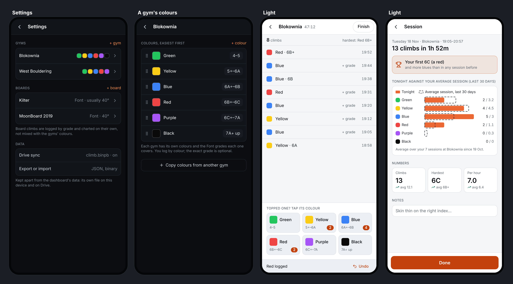

# Climbing log: design

**Status:** proposal, second round, after the review of the first one.
Nothing is built yet. The screenshots come from a prototype with sample data
(branch `proto/climb`, not for merging), so both the features and the look
can still change.

## In short

- **A second app in this repository,** made for a phone at the gym:
  bouldering at gyms (each gym with its own colours) and on boards (Kilter,
  MoonBoard…). It has its own page (`/climb/`) and its own icon on the home
  screen. The dashboard links to it, and it links back; nothing else
  connects them.
- **One tap logs one climb:** when you top a problem, tap its colour (on a
  board, its grade). Undo is in the bar at the bottom.
- **What it's for:**
  - how many climbs you complete, and at which grades;
  - whether that's getting better: against your past sessions, and over a
    period you pick.
- **Its data is kept apart from the dashboard's:**
  - its own protobuf schema;
  - its own storage on the phone;
  - its own file on Drive.

  The code that saves and syncs is shared.





## The first round's answers

| Question | Answer | What it means here |
|---|---|---|
| Colours or Font on the tags? | Colours, per gym | Each gym has its own colours, each covering a range of Font grades. You log by colour; the exact grade is optional. |
| Ropes too? | Bouldering first | No ropes in the first version. The data leaves room for them. |
| Count tries? | Not for now | No tries, no flash, no "not sent": a climb logged is a climb topped. |
| Accent | Orange | Kept. |
| Should the dashboard know about climbing? | No, now or ever | Only the links. A session never starts by itself, from the calendar or anything else: only **Start**. |
| Boards | Yes, sometimes | Boards are a kind of place: climbs by grade, and the board's angle per session. Charted apart from the gyms. |
| Photos | No | Out. |
| Weekly goal | No goals | Out. |

**"Projects" are gone.** In climbing, a project is a problem you keep
working on over several sessions until you finally top it. Tracking one
needs tries and "not sent yet", which you don't want to log, so there's
nothing for it to show. If tries come back later, projects can come back
with them.

## User stories

**At the gym:**
1. When I arrive, I tap **Start**. I want the gym I went to last to be
   picked already, so starting takes one tap.
2. When I top a problem, I tap its colour, so logging takes a second and
   doesn't break my rest.
3. When I tap the wrong colour, one **Undo** fixes it.
4. When the tag says the exact grade, I can add it afterwards. It's never
   required.
5. On the board, I tap the grade, and the board's angle is kept with the
   session.
6. When I'm done, I tap **Finish**. I see how tonight compares with my
   usual session at this gym (more blues than usual? fewer reds?) and any
   firsts ("your first 6C").

**Later, at home:**
7. I pick any period (last 30 days, 3 months, this year, all time, or two
   dates) and see how many climbs I did and at which grades, against the
   period before.
8. I see whether my grades are going up: my typical climb and my 5 hardest,
   week by week.
9. I see how my volume changes: climbs per week, by grade.
10. I see how often I climb: sessions a week.
11. I look at boards apart from the gyms, and at one gym apart from the
    others, since grades aren't the same everywhere.

**Setting up and my data:**
12. I set up each gym's colours (and their grades) once, and copy them from
    another gym when they're alike.
13. My climbing data is mine and separate from the dashboard: its own file,
    exportable, synced to my Drive if I want.

## What to measure

What climbers and coaches track to see progress, and what fits a log
without tries:

| Measure | Why | Where |
|---|---|---|
| **Climbs**, in a session and in a period | Volume: the simplest sign you're climbing more | After the session; Progress; Today |
| **Climbs by grade** (the "pyramid") | Progress shows as the middle and the top filling in. Coaches suggest about 3–4 climbs of each grade for every one of the grade above before pushing it. | After the session (by colour); Progress (by grade) |
| **Typical grade** (the median) | The grade you mostly climb. One odd session barely moves it. | Progress: a number, and a line week by week |
| **Average of your 5 hardest** | Your level at the top, steadier than the single hardest climb: one lucky send doesn't make it jump. The same idea as 8a.nu's ranking, which counts your best 10 ascents. | Progress: a number, and a line week by week |
| **Hardest climb** | Motivating, but noisy | Progress; After the session (firsts) |
| **Sessions a week** | Consistency, which is what makes the rest move | History; Progress |
| **Climbs per session, per hour** | How much you get out of a session | After the session; Progress |

**Left out**, since they need what isn't logged:
- **Flash rate** and **send rate:** they need tries and "not sent".
- **A cumulative score** (e.g. a log-weighted "performance grade"): harder to
  read than the measures above, for little more.

**Caveats:**
- **Grades differ between gyms.** Progress can show one gym on its own.
- **Boards grade harder, and depend on the angle.** Board climbs are always
  charted apart from the gyms.
- **Climbs logged by colour only** count at the easiest grade of their
  colour in charts by grade: "at least 6B+" for a red, never a guess.

## Charts and numbers

**After the session:**
- **"Tonight against your average session"** (first image, 4th screen):
  - **The bars:** one row per colour of the gym (on a board, per grade);
    tonight is a filled orange bar, and your average session at this gym
    over the last 30 days is a long-dashed outline, not filled, on the same
    scale.
  - **The numbers** beside each row: "4 / 4.5".
  - **The average** is over your sessions at the same gym (or board) in the
    30 days before, not counting tonight.
- **Three numbers,** each against that average: climbs, hardest, climbs per
  hour.
- **Firsts:** a grade above any before, or more of a colour than in any
  session before.

**Progress, for any period you pick:**
- **The period:**
  - presets (last 30 days, last 3 months, this year, all time) or two
    dates;
  - compared with the same length just before (the default), the same dates
    a year earlier, or nothing.
- **Gym or Board,** and all gyms or one.
- **Six numbers,** each against the comparison period: climbs, sessions,
  climbs per session, typical grade, average of the 5 hardest, hardest.
- **Climbs by grade:** the same bars as after the session. This period is
  filled; the comparison period is the dashed outline.
- **Climbs per week, by grade:** stacked columns, easy at the bottom in
  light blue, hard at the top in dark blue. A darker top over the weeks
  means harder climbs.
- **Grades, week by week:** two lines on the grade scale, the average of
  your 5 hardest and your typical climb. A week without climbing is a gap,
  not a zero.
- **Every chart has a table** of the same numbers ("table"). Tapping a bar
  or a point shows its numbers.

**History:** sessions a week, then every session, with its place, length,
climbs and hardest climb.

**Colours in charts:**
- **Kept:** the dashboard's chart rules, checked with the same
  colour-blindness and contrast tests on the dark and the light background.
- **One series:** orange; the past is always a long-dashed outline in the
  text colour.
- **Two lines:** orange and blue.
- **Grades:** one blue, light to dark.
- **Readable without colour:** every chart has a legend and numbers on it.
- **Gym colours** appear as swatches beside their names, never as chart
  colours.

## Screens

**Getting around:**
- **Tabs:** Today, Progress, History.
- **Top right:** **Dashboard** and Settings.
- **A running session** is a screen of its own, without tabs.

**Each screen:**
- **Today:**
  - where you'll climb (the last place, changeable) and **Start a session**;
  - this month so far against the last: climbs, sessions, hardest;
  - the last session.
- **At the gym:**
  - the gym and the time so far, with **Finish**;
  - the climbs so far, newest first (tap one to add its grade);
  - at the bottom, in the thumb's reach, the gym's colours as big buttons,
    each with tonight's count and its grades;
  - the undo bar.
- **On a board:** the same, with the board's grades (Font or V) instead of
  colours, and the angle in the header (changeable). A climb can get the
  problem's name afterwards.
- **After the session:** the comparison chart, the numbers, firsts, notes,
  **Done**.
- **Progress:** see Charts and numbers.
- **History:** sessions a week, and every session.
- **Settings:**
  - **Gyms**, each with its colours: their order (easiest first) and the
    Font grades each covers. A gym's colours can be copied from another
    gym.
  - **Boards:** grades and usual angle.
  - **Data:** export and import, Drive sync.
  - **The theme.**

**How many taps:**

| To… | Taps |
|---|---|
| Start a session at the usual gym | 1 |
| Log a climb | 1 |
| Undo it | 1 |
| Add a climb's exact grade | 2 |
| Finish and see how it went | 1 |
| Change the period on Progress | 2–3 |

## Grades

- **Gyms:** colours, each a range of Font grades, set per gym. A climb's
  exact grade (Font) is optional.
- **Boards:** Font or V, and the angle per session. MoonBoards run at 25° or
  40° (the same problem is easier at 25°); Kilter boards from 0° to 70°.
  Board climbs are never mixed with gym climbs in charts.
- **Charts are in Font** unless V is chosen in Settings. A V grade is
  converted with the table below, marked with "≈". The sources agree on
  the ends but differ in the middle of the scale.

| Font | 4 | 5 | 5+ | 6A, 6A+ | 6B, 6B+ | 6C, 6C+ | 7A | 7A+ | 7B, 7B+ | 7C | 7C+ | 8A |
|---|---|---|---|---|---|---|---|---|---|---|---|---|
| **V** | V0 | V1 | V2 | V3 | V4 | V5 | V6 | V7 | V8 | V9 | V10 | V11 |

## Where it lives

- **Code:** this repository, the same build. The log is a second page,
  `climb/index.html`, with its code in `src/climb/`.
- **Address:** `https://wps0.github.io/personal-dashboard/climb/`.
- **Links:** plain links in the same tab, and nothing else. From the
  dashboard: "Climbing" after the page tabs on a computer; a mountain icon
  next to Settings on a phone with tabs; "Climbing log" under Other apps in
  the ☰ menu. In the log, **Dashboard** at the top of every screen goes
  back.
- **Its own install:** its own manifest, name ("Climb") and icon. To check
  in the first PR: that Android installs it as an app of its own, since its
  address sits inside the dashboard's.
- **Offline:** one service worker for both pages. The log works at the gym
  without a signal.

### The data, kept apart

| | Dashboard | Climbing log |
|---|---|---|
| Schema | `proto/dashboard/data.proto`, package `dashboard` | `proto/climb/climb.proto`, package `climb` |
| Generated code | `src/gen/dashboard/` | `src/gen/climb/` |
| Schema version, migrations | its own | its own, from 1 |
| On the device | its IndexedDB database | another IndexedDB database, `climb` |
| On Drive | `personal-dashboard.binpb` (+ `.json`) | `climb.binpb` (+ `climb.json`) |
| Lock against two open tabs | its own | its own |

- **Neither imports the other's schema or model.** A change to one can't
  break the other, and each file can be exported, imported or deleted on
  its own.
- **Shared, made generic over the schema and the names:**
  - the codec (binary and JSON, the schema version check, migrations);
  - autosave;
  - IndexedDB storage;
  - Drive sync with its three-way merge and conflict review;
  - Google sign-in.
- **The first PR is that refactor alone,** with no change to the dashboard.
  Tests show it reads and writes exactly the bytes it did before.
- **The Google Client ID setting is shared,** so it's set once; sign-in is
  per app.
- **Both apps are on the same origin** (see the dashboard's own-subdomain
  TODO); the log's only secret is the Google token.

## Data model (sketch)

Following the dashboard's rules: numeric enums with an unset value, no
nested messages, fields from 1, `optional` where a field can be unset, and a
schema version from the start. Adding tries, flashes or ropes later is
adding fields, which older versions keep.

```proto
syntax = "proto3";
package climb;

message ClimbData {
  int32 schema_version = 1;
  repeated Place places = 2;
  repeated Session sessions = 3;
  repeated Climb climbs = 4;
  Settings settings = 5;
}

message Place {
  string id = 1;
  string name = 2;
  PlaceKind kind = 3;              // GYM or BOARD
  repeated Colour colours = 4;     // gyms: easiest first
  GradeSystem grades = 5;          // FONT or V
  optional int32 usual_angle = 6;  // boards, in degrees
  bool archived = 7;
}

enum PlaceKind {
  PLACE_KIND_UNSPECIFIED = 0;
  PLACE_KIND_GYM = 1;
  PLACE_KIND_BOARD = 2;
}

enum GradeSystem {
  GRADE_SYSTEM_UNSPECIFIED = 0;
  GRADE_SYSTEM_FONT = 1;
  GRADE_SYSTEM_V = 2;
}

message Colour {
  string id = 1;                   // stays when renamed or moved
  string name = 2;                 // "Red"
  string hex = 3;                  // "#ef4444"
  string easiest = 4;              // "6B+"
  optional string hardest = 5;     // "6C"; unset: and up
}

message Session {
  string id = 1;
  string place_id = 2;
  string date = 3;                 // YYYY-MM-DD
  string start = 4;                // HH:MM
  optional string end = 5;         // unset while it runs
  optional int32 angle = 6;        // boards
  string notes = 7;
}

// One climb topped.
message Climb {
  string id = 1;
  string session_id = 2;
  string at = 3;                   // HH:MM
  optional string colour_id = 4;   // gyms
  optional string grade = 5;       // optional at gyms, always on boards
  optional string name = 6;        // boards: the problem's name
}

message Settings {
  GradeSystem chart_grades = 1;    // unset: Font
}
```

## What the numbers mean

- **A climb:** one problem topped, logged with one tap.
- **A climb's grade:** its exact grade if it has one, else its colour's
  easiest grade.
- **Typical grade:** the median of the period's climbs' grades.
- **Average of the 5 hardest:** the period's 5 hardest climbs, averaged on
  the grade scale and shown as the nearest grade. With fewer than 5 climbs,
  it's the average of those there are.
- **Average session** (after the session): climbs per colour (or grade),
  averaged over the sessions at the same place in the 30 days before.
- **Climbs per hour:** climbs ÷ the session's length.
- **The comparison period:** by default the same length just before ("the
  3 months before").
- **A first:** a grade above every earlier climb of that kind (gym or
  board), or more climbs of a colour than in any earlier session there.

## Plan

Small PRs, each checked in the browser like the dashboard's:

1. **Generic saving:** the saving code made generic over the schema (the
   dashboard unchanged, its bytes checked).
2. **The shell:** the `/climb/` page, its tabs, the links both ways, the
   manifest and icon, and the service worker.
3. **The data:** `climb.proto`, storage and autosave, export and import;
   Settings for gyms, colours and boards.
4. **Sessions:** start and finish, one-tap logging at gyms and on boards,
   undo, and an exact grade or a name afterwards.
5. **After the session:** the comparison chart, the numbers, firsts.
6. **Progress:** the period picker, the numbers, climbs by grade, climbs per
   week, the grade lines, and the tables.
7. **History.**
8. **Drive sync** to `climb.binpb`.

## Open questions

1. **Exact grades at gyms:** offer them (optional, as shown), or colours
   only?
2. **The board angle:** per session (as shown), or per climb?
3. **"Your average session":** the last 30 days at the same gym (as shown),
   or your last 5 sessions there?
4. **Charts across gyms:** by grade, with a colour-only climb counted at its
   colour's easiest grade (as shown). With one gym picked, should "Climbs by
   grade" show that gym's colours instead?
5. **The name:** "Climb"?

## Sources (checked November 2026)

- What to track and how pyramids are read:
  - [ClimbStrong: quantifying bouldering sessions](https://climbstrong.com/education-center/quantifying-bouldering-sessions);
  - [8a.nu: the base of your pyramid](https://www.8a.nu/news/focus-on-the-grade-base-of-your-pyramid);
  - [Power Company: not all pyramids are built the same](https://powercompanyclimbing.squarespace.com/blog/2020/5/6/not-all-pyramids-are-built-the-same);
  - [Mountain Project: a "stable pyramid"](https://mountainproject.com/forum/message/111542163);
  - [AscentStats: a cumulative performance grade](https://ascentstats.com/cumulative-performance-grade/);
  - [KAYA Pro](https://kayaclimb.com/blog/whats-kaya-pro).
- Ranking on your best ascents:
  - [8a.nu user guide](https://www.8a.nu/articles/user-guide-and-faq-1327);
  - [8a.nu on the top-10 ranking](https://www.8a.nu/news/-49730).
- Boards:
  - [Moon Climbing: using your MoonBoard](https://eu.moonclimbing.com/using-your-moonboard);
  - [Lattice: a MoonBoard logbook](https://latticetraining.com/blog/ben-moons-moonboard-logbook);
  - [theCrag: Kilter logbooks](https://www.thecrag.com/en/climbing/virtual/area/5170450323/search).
- Font and V: [Masterclass](https://www.masterclass.com/articles/bouldering-grades-explained),
  [Planetmountain](https://www.planetmountain.com/news/2004/03/boulderinggrades.html),
  [Mammut](https://www.mammut.com/es/en/stories-guides/bouldering-difficulty-scales-explained-climbers-guide),
  [DPM Climbing](https://www.dpmclimbing.com/?p=1314).
- Logbook apps:
  - [TopLogger](https://apps.apple.com/au/app/toplogger/id1289479862);
  - [Sendtally](https://play.google.com/store/apps/details?id=com.sendtally.app);
  - [BetaFlow](https://apps.apple.com/us/app/id6752315334).
